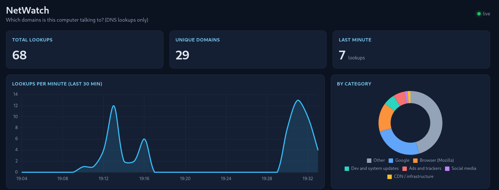
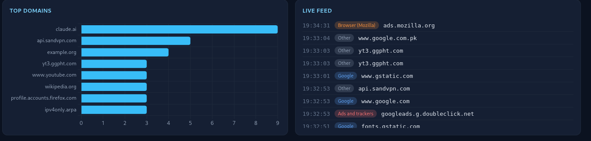

# NetWatch

A small tool that shows which domains your own computer is talking to. It watches
DNS lookups on your machine, saves them to a local database, groups them into
categories (Google, ads and trackers, social media, and so on) and shows them on a
live dashboard in your browser.

## Why I built it
Every time a computer opens a website or an app contacts a server, it first asks DNS
for the address. That traffic is normally invisible. I built NetWatch to learn how
network packets and DNS work, and to practise building a live dashboard from real data.

## What it shows
- Total lookups, unique domains and lookups in the last minute
- Lookups per minute over the last 30 minutes
- Breakdown by category and the most-contacted domains
- A live feed of the latest lookups

## What it cannot show
DNS reveals only the **domain name** (for example `github.com`), not the page, the
path or the content. HTTPS encrypts all of that. This is also roughly what anyone on
your network can see about you.

## How it works
1. `capture.py` listens for DNS questions (UDP port 53) using Scapy.
2. `categories.py` labels each domain with a simple list of rules.
3. `db.py` stores the lookups in SQLite, using parameterized queries.
4. `app.py` serves the data as JSON to a dashboard that refreshes every 2 seconds.

## Run it (Linux)
You need Python 3, `tcpdump` and `libcap2-bin` installed.

    git clone https://github.com/sysrupt123/netwatch.git
    cd netwatch
    python3 -m venv --copies venv
    source venv/bin/activate
    pip install -r requirements.txt
    readlink -f venv/bin/python
    sudo setcap cap_net_raw,cap_net_admin=eip $(readlink -f venv/bin/python)
    cp venv/bin/python venv/bin/python-web

The `readlink` line must print a path inside the project folder. If it prints
something under `/usr/bin`, stop: the capability must only go on the private copy.

Then use two terminals, both with the venv activated for the first one:

    python capture.py
    venv/bin/python-web app.py

Open http://127.0.0.1:5001

## Security notes
- **Least privilege:** only the capture process has permission to sniff packets
  (set on one private copy of Python). The web server runs from a copy without it.
  Nothing runs as root.
- **Parameterized SQL:** domain names come from the network, so they are treated
  as untrusted input.
- **No HTML injection:** the dashboard uses `textContent` and canvas charts, never
  `innerHTML`, so a hostile domain name cannot run as script.
- The dashboard listens on `127.0.0.1` only, with debug mode off.
- Data stays on your machine in `traffic.db`, which is not committed to Git.

## Limitations
- DNS only: no URLs, no page content, and only IPv4 (type A) lookups are counted to
  avoid double-counting.
- Encrypted DNS (DNS over HTTPS/TLS) in a browser or OS bypasses it.
- Counts are lookups, not visits: cached lookups do not generate new queries.
- Categories are a small hand-made list, so many domains show as "Other".
- The dashboard has no login. That is fine on localhost; do not expose it.
- Tested on Kali Linux only. Not audited. Use it only on your own machine and network.

## Built with
Python, Scapy, Flask, SQLite and Chart.js 4.4.1 (MIT licence, included in `static/`).
Written with AI assistance (Claude); I tested it and can explain how each part works.

## License
MIT
